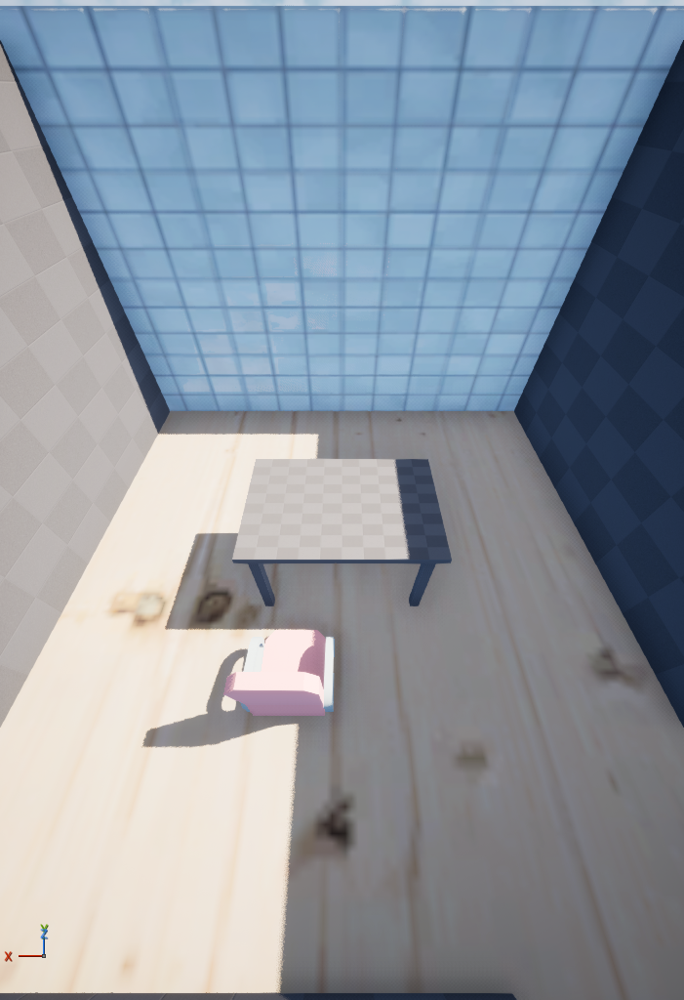

# Pipeline: execucao limitada e resultados — 22/10/2026

## Publicacao e escopo

PR #85 publicou as provas nativas USD e a tentativa convexa limitada. PR #86
ampliou a ajuda de objeto apos falha real de descoberta no Luna; instalacao
estavel em 6a96307 antes desta entrega. Nenhuma mudanca nos executores ou
representacao espacial foi necessaria para os resultados abaixo.

Somente Luna/openai-codex/low no Hermes. Duas sessoes, uma retomada da primeira;
nenhum GLM, bateria extensa ou novo download. Scripts de experimento, dados,
fotos e backup SQLite: `R:/CINF/BD/Director/pipeline-20261022/`.

## Pedido e correcao pelo Hermes

Fixture separada `piloto_acervo20261022`: sala 4x4 m, porta e mesa existentes.
Pedido: escolher cadeira pronta no acervo importado sem ID fornecido, colocar
cadeira_piloto em (2;1,2) m, 50x50x83 cm e preservar os objetos anteriores.

| Rodada | Resultado observado | Limite |
|---|---|---|
| Primeira | Encontrou chairDesk/Kenney, escreveu ficha, nao executou objeto em seis rodadas; 42,046 s | NAO ATENDIDO nessa rodada. Releu API/capacidades/contratos; ajuda insuficiente contribuiu, sem prova de causa unica |
| Retomada | Executou a ficha, observou e verificou; 34,120 s | ATENDIDO com intervencao de retomada. Corrigiu uma entrada JSON literal para arquivo. Nao prova efeito causal da ajuda nova sozinha |
| Correcao curta em sessao nova | Mudou somente x de 200 para 230 cm, demais campos e objetos preservados; 24,094 s | Resultado espacial confirmado independentemente. CLI saiu 1 ao atingir limite de tres rodadas, apesar das operacoes executadas; nao confundir esse status com rollback ou ignorar o limite |

Sessao principal: `local-3cfe555c7a825aa0006ea97d01ce6e5985f18091702e7bbd7627a1c15f3fde40`.
Correcao: `local-a2f1ebc190d8e52695d7325ca2b775f1b70f05945613708df0b2a4dae035a677`.
Retornos brutos podem estar truncados pelo terminal; o Codex consultou o motor
independentemente. Objetos mesa/porta/sala permaneceram iguais na planta.
Verificacao nativa breve: cadeira com fisica ativa, deslocamento/giro/velocidades
zero; mesa fixa nao foi chamada de corpo dinamico. Rota de uso ate a cadeira e
interacao com personagem nao foram verificadas.

## Materiais: criterios da #35

Piso de madeira clara aplicado com caminho nativo; parede norte de azulejo
branco selecionada por descricao dentre materiais ja importados. Planta e
materiais persistiram apos salvar, carregar L_sala e reabrir o ensaio. Foto
`madeira-azulejo.png` foi aberta e inspecionada; iluminacao pode tingir o branco,
nao houve afericao colorimetrica ou ajuste cosmetico de luz.

Imagem capturada no laboratorio pelo MCP, sem edicao generativa. Materiais do
piloto ambientCG CC0; cadeira do piloto Kenney. Nao e cena cinematografica.

Cinco raios (quatro paredes e piso) e caminho de navegacao antes/depois identicos:
rota nao parcial de 300 cm entre (50,300) e (350,300). Atores/transformacoes e
objetos anteriores preservados. Material inexistente recusado e planta inteira
identica antes/depois da recusa. Evidencias: material-persistencia.json e
materiais-conclusao.json. Isto satisfaz os exemplos e criterios escritos da
#35; nao certifica toda textura nem aplica material ao filme.

## Topview: incorporacao pequena no catalogo

Um personagem e duas poses originais ja baixadas catalogados via funcoes do
acervo existente, sem SQL gerado pela LLM: fonte topview-builtin, hashes,
atribuicao CC BY 4.0, tags PT/EN e rig **declarado** mixamorig. Personagem ligado
ao SkeletalMesh V3 importado no ensaio anterior. Repeticao idempotente confirmou
tres objetos; quick_check ok e FK sem violacoes. Nao foram baixadas as 121 poses.

O formato de pose e registrado como delta quaternion mundial sobre rest, com
conversao necessaria. Registro nao transforma pose em AnimSequence nem torna
`objeto` compativel com SkeletalMesh. Movimentos Mixamo, retarget Manny e operador
automatico de personagens continuam pendentes. Dimensoes/fisica desconhecidas
na ficha nao foram preenchidas artificialmente.

## Aprendizado e prioridade restante

Skill 0.5.21 acrescenta protocolo curto inspirado no Topview: requisitos e
evidencias no registro existente em pedidos complexos; ajuda especifica antes
de API generica; retomar ficha pronta; desconhecido nao e aprovado. Nao adiciona
BOM paralelo, solver ou novas aprovacoes. E orientacao, nao mecanismo automatico
de certificacao de requisitos; comportamento novo ainda requer medicao futura.
Instalacao do perfil conferida igual aos templates publicados, com backup da
skill anterior. Gateway nao foi reiniciado; nenhuma inferencia adicional foi
feita para afirmar eficacia das instrucoes novas.

## Matriz de retomada (sem perder o pipeline)

| Item | Entregue nesta rodada | Proximo gate |
|---|---|---|
| 1 Acervo nativo | Dois USDs v2, escala/montagem e reuso conferidos | Associacao de instancia/parte e provas por variante importada |
| 2 Funcionalidade | Colisao ruim reproduzida; uma alternativa nativa reprovada | Outra solucao/candidato para interacao interna; juntas Chaos nao implementadas |
| 3 Interface Topview | Ajuda acionavel e protocolo na skill, usando registros existentes | Validar lista de requisitos e evidencias na conversa; sem BOM paralelo |
| 4 Ciclo Luna | Escolha de cadeira pronta, colocacao, fisica breve e correcao preservando objetos | Repetir sem intervencao em variante; aquisicao remota + cena no mesmo pedido nao comprovadas |
| 5 Materiais | Piso/parede, foto, salvar/reabrir, colisao/nav identicos, recusa de inexistente | Criterios escritos da #35 satisfeitos; nao e certificacao de todo material |
| 6 Topview | Um boneco e duas poses no SQL, procedencia/rig/arquivo/importacao; idempotente | Importacao/conversao automatica pelo operador e um movimento Mixamo |
| 7 PA/contexto | Dois pedidos pequenos e uma retomada, sucessos e falhas preservados | Variacoes/corredor/casa e comparacao Qwen Q8/Q4 quando disponiveis |
| 8 Publicacao | PR85/86/87 e checkpoint final; estavel atualizado por bloco | Manter a mesma rotina nas proximas entregas |

Proximos gates: validade por parte/variante e montagem generica (#75/#36);
colisao funcional da estante ainda reprovada (uma tentativa nativa, sem ajuste
repetitivo); PA com variacoes e correcao sem intervencao (#4/#68); comparacao
controlada de contexto/Qwen Q8/Q4 (#39). #6 app, #17 reboot/redundancia, #22
sessoes restritas e #38 cancelamento/interface conservam suas provas proprias.

Encerramento: L_sala original restaurado; 48 atores com mesmos caminhos,
posicoes, rotacoes e escalas do snapshot inicial. Sem Play ativo. Dados e assets
dos ensaios ficam separados; a planta modificada por outro trabalho no checkout
de desenvolvimento permanece fora dos commits.
